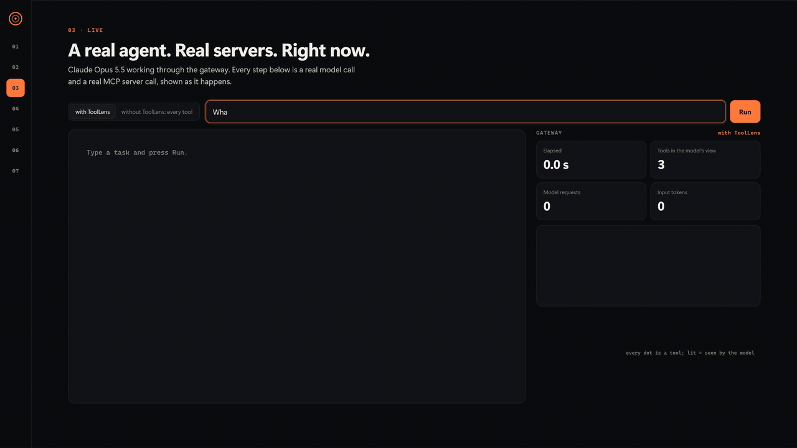
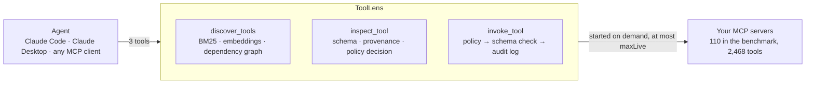

<div align="center">

# 🔍 ToolLens

### Give your agent 2,468 tools. It sees 3.

**An MCP gateway in Rust. Put any number of MCP servers behind it: your agent discovers, inspects and
calls exactly the tools it needs, and finding a tool never grants permission to run it.**

[](https://github.com/krishnashakula/toollens/actions/workflows/ci.yml)
[](LICENSE)
[](https://www.rust-lang.org/)
[](https://modelcontextprotocol.io/)
[](CONTRIBUTING.md)



<sub>Real run, not a mock-up: Claude Opus 5.5 against 110 vendor-published MCP servers. Full 4K/60 fps video in the <a href="https://github.com/krishnashakula/toollens/releases/tag/v0.1.0">v0.1.0 release</a>.</sub>

</div>

---

MCP clients send **every tool definition with every request**. Connect enough servers and that stops
working: the 110 real vendor servers in this repo's benchmark expose 2,453 tool definitions, which
come to **1.43M tokens per request, and the API rejects every call** before the model runs. Below
that limit you still pay for, and distract the model with, hundreds of tools it will never use.

ToolLens sits between the agent and your servers and shows the agent three tools instead:

| Tool | What it does |
|---|---|
| `discover_tools(goal, limit?)` | Up to 10 tool ids for a goal: direct matches **plus the tools they depend on**, each with the reason it is there |
| `inspect_tool(tool_id)` | Full input/output schema, server provenance, and the current policy decision |
| `invoke_tool(tool_id, arguments)` | Checks policy, validates the arguments against the schema, then forwards the call to the owning server |

## Results

Same 28 tasks, same model (Claude Opus 5.5), 110 real MCP servers, 2,468 tools:

| | Every tool exposed | **ToolLens** | Anthropic's built-in tool search |
|---|---:|---:|---:|
| Tasks completed | **0/28** (every request rejected) | **26/28** | 25/28 |
| Tool tokens per request | 1,428,973 | **951** | 643 |
| Input tokens per task | n/a | **18.4K** | 25.5K |
| Cost per task (list price) | n/a | **$0.043** | $0.090 |

One run per task: 26 vs 25 is a tie. The result is that ToolLens matched Anthropic's server-side
tool search at **half the cost per task**, while exposing every tool was not an option at all.
Methodology, the controlled benchmark and every caveat are [below](#benchmarks); every number comes
from transcripts committed in [`bench/results/`](bench/results).

## Quick start

Download the archive for your platform (Linux x86_64, macOS Apple silicon, Windows x86_64) from the
[latest release](https://github.com/krishnashakula/toollens/releases/latest) and unpack it. Or
build from source with Rust 1.89+, then use `./target/release/toollens`:

```bash
git clone https://github.com/krishnashakula/toollens && cd toollens && cargo build --release
```

From the unpacked folder:

```bash
# Three simulated servers (deploy, observability, vcs) plus 982 generated distractor tools:
./toollens discover --config examples/gateway.json --noise 982 --goal "investigate a failed deployment"
```

On macOS the binary is unsigned; if it is blocked, run `xattr -d com.apple.quarantine toollens`.

```jsonc
{
  "tools": [
    { "id": "deploy/get_deployment",   "role": "match",      "why": "matches fail, deploy" },
    { "id": "deploy/list_deployments", "role": "dependency", "why": "provides `deployment_id` that deploy/get_deployment requires" },
    { "id": "deploy/search",           "role": "dependency", "why": "provides `service_id` that deploy/list_deployments requires" },
    { "id": "vcs/get_commit",          "role": "dependency", "why": "can use `commit_sha` returned by deploy/get_deployment" },
    { "id": "observability/get_logs",  "role": "dependency", "why": "can use `deployment_id` returned by deploy/get_deployment" }
    // … 3 more direct matches
  ],
  "catalog_size": 1000,
  "latency_ms": 0.27
}
```

Keyword search alone finds the deployment tool. The dependency graph adds the chain the agent will
actually need: the lookup that resolves a service name to its id, the logs, and the commit.

## Use it from Claude Code, Claude Desktop or any MCP client

**1. Put your servers behind the gateway.** `gateway.json` uses the same `mcpServers` shape as
Claude Desktop and Claude Code, so you can paste your existing server list into it, then add a
`policy`:

```json
{
  "mcpServers": {
    "github": { "command": "npx", "args": ["-y", "@modelcontextprotocol/server-github"], "env": { "GITHUB_PERSONAL_ACCESS_TOKEN": "..." } },
    "filesystem": { "command": "npx", "args": ["-y", "@modelcontextprotocol/server-filesystem", "/work"] }
  },
  "policy": { "default": "allow", "deny": ["github/merge_pull_request"], "allow": [], "denyDestructive": true }
}
```

**2. Point your client at ToolLens instead of at the servers.** For Claude Code use `.mcp.json` at
your project root; Claude Desktop uses `claude_desktop_config.json`:

```json
{
  "mcpServers": {
    "toollens": {
      "command": "/path/to/toollens",
      "args": ["serve", "--config", "/path/to/gateway.json"]
    }
  }
}
```

The agent now sees three tools however many servers sit behind them. To check what a goal would
find before involving an agent: `toollens discover --config gateway.json --goal "..."`.

For many servers, set `"lazy": true` (and optionally `"maxLive": 12`): tool lists are indexed once
and cached in SQLite, and each server starts only when one of its tools is called, with at most
`maxLive` running and the least recently used stopped first. Bare launcher names such as `npx` and
`uvx` resolve on Windows too.

The end-to-end test drives `serve` with the official rmcp client over stdio. It has **not** been
tested inside Claude Desktop or Claude Code yet; reports welcome.

## The console

```bash
./target/release/toollens console --config examples/gateway.json --noise 982
#   ToolLens console: http://127.0.0.1:7300/#token=…
```

A local web UI over the running gateway: browse the catalog, try discovery for any goal, replay
recorded benchmark runs, and run a live agent (needs `ANTHROPIC_API_KEY`) to watch every
discover, inspect and invoke step as it happens, next to the gateway's own audit log. The demo above
is this console. It binds to 127.0.0.1, and every API call needs the token it prints.

## How it works



1. **Index.** Servers start six at a time with a timeout each; one that fails is reported with its
   last stderr lines and the rest keep working. Names, descriptions, input and output schemas and
   server identity are indexed. Ids are `server/tool`, so overlapping names (`get_status` exists
   on 13 servers in the demo) are never ambiguous.
2. **Retrieve.** BM25 keyword search (default), semantic search (Ollama embeddings, cached in
   SQLite), or a hybrid of the two (reciprocal rank fusion). At most two direct matches per tool
   family, so five CRUD variants of one near miss cannot fill the result.
3. **Expand with dependencies.**
   - **Schema edges:** tool A's output has a field that tool B takes as input. Producers that
     resolve names to ids rank first, and each shared field is weighted by how rare it is, so
     `commit_sha` is strong evidence and `service_id` is weak. Tools of different servers are
     linked only through fields used by at most 3 servers: across real vendors, `region` matching
     is coincidence, not a data flow.
   - **Observed edges:** B was called successfully with a value A returned earlier in the same
     session. Learned at runtime and persisted.

   Destructive tools are never suggested as speculative next steps, and dependencies fill at most
   half the result slots, so they never push out the best direct matches.
4. **Execute.** Policy is checked; arguments are validated against the JSON schema (failing closed
   if the schema itself is broken); the call is forwarded with a 30 s timeout, and a timeout or a
   client cancellation cancels it upstream through MCP. At most 8 calls per server are in flight.

## Security model

- **Discovery never grants permission.** Policy is checked on every invoke and nowhere else.
  Deny globs win; then `denyDestructive`; then allow globs; then the default. With no `policy`,
  everything is denied, and a misspelled policy key fails the config instead of being ignored.
- **Server annotations may only tighten policy.** `denyDestructive` denies tools a server marks
  `destructiveHint: true` unless an allow glob names them.
- **Upstream servers never see the gateway's secrets.** They get system basics plus their own
  configured `env`, never the gateway's environment (API keys).
- **Nothing sensitive reaches the model or the audit log.** Provenance shows a server's program
  name, never its arguments (which often carry credentials). The SQLite audit log records argument
  names, never values.
- **The console is not an open door.** Binding to 127.0.0.1 is not enough on its own: Docker
  containers and DNS-rebinding pages can reach it. Every API call needs the per-start token.

Found a hole? See [SECURITY.md](SECURITY.md).

## Known limitations

- `denyDestructive` acts only on tools explicitly annotated `destructiveHint: true`. Tools with no
  annotations are not treated as destructive (the MCP spec's default would be); deny them by glob.
- Lazy mode trusts the cached tool list until `--reindex`. Pin server versions (`pkg@1.2.3`, image
  digests) so an upstream update cannot change a tool behind the gateway's back.
- `maxLive` is not a hard bound: a server evicted while one of its calls runs keeps running until
  that call ends, and a new call can start a second copy.
- Concurrent first calls to a server that fails to start wait in turn; there is no backoff.
- Benchmarks: one model, one run per task, tasks written alongside the system.

## Benchmarks

Two benchmarks, both on Claude Opus 5.5 at effort `medium`, one run per task. Every tool call goes
through the same gateway policy and validation, and metrics are read back from the gateway's audit
log.

### Real world: 110 vendor MCP servers, 2,468 tools

**The catalog.**
- Every server is a published npm or PyPI package whose registry metadata links to the vendor's own
  GitHub organization, or that sits under the vendor's own npm scope. Examples: AWS Labs (51
  servers), GitHub, GitLab, Slack, Notion, Stripe, PayPal, Twilio, DigitalOcean, Heroku, CircleCI,
  MongoDB, ClickHouse, dbt, Playwright, Context7.
- 137 packages were verified; 112 started inside the sandbox, and 2 of those expose no tools
  without an account, which leaves 110. The 25 that did not start are listed in
  [`bench/real/index-report.json`](bench/real/index-report.json): dependency rot in the published
  package, a required CLI or OAuth login, a startup credential check that rejects the dummy key, or
  a crash.
- Each server runs in its own Docker container
  ([`bench/real/sandbox.Dockerfile`](bench/real/sandbox.Dockerfile)) with **dummy credentials**.
  Tools are real; calls to keyed services fail authentication, so no account is touched.

**The tasks.** 28 ([`bench/real/tasks.json`](bench/real/tasks.json)): 6 answer tasks run end to end
on servers that need no key (time, fetch, git, filesystem, AWS documentation); 22 selection tasks
pass when the agent calls a correct tool with schema-valid arguments (the call then fails on the
dummy key). Two leave the vendor open: "geocode the Eiffel Tower" accepts any of 4 geocoders, and
"search the web" any of 7 search tools.

**The three arms.** *Full catalog:* every tool registered with the API. *ToolLens:* the three
tools. *Native tool search:* Anthropic's server-side BM25 tool search, every tool sent with
`defer_loading`.

| | Full catalog | **ToolLens** | Native tool search |
|---|---:|---:|---:|
| Tasks completed | **0/28** (every request rejected) | **26/28** | 25/28 |
| Tool tokens per request | 1,428,973 | 951 | 643 |
| Model requests per task | n/a | 5.5 | 2.8 |
| Input tokens per task | n/a | 18.4K | 25.5K |
| Cost per task (list price) | n/a | $0.043 | $0.090 |
| First tool tried was a correct one | n/a | 78% | 79% |
| Wrong tools tried (all tasks) | n/a | 4 | 6 |
| Median wall time per task | n/a | 13 s | 110 s |

What this says:
- **Exposing every tool is not an option.** Every request is rejected with `prompt is too long:
  1429159 tokens > 1000000 maximum`. Real tools are heavy: about 580 tokens each, against about 90
  for synthetic ones. Separately, **15 real tools cannot be registered with the API at all**: their
  schemas use property names such as `$vectorSearch` or `EndTime<` (Twilio, MongoDB, Contentful,
  Postman), and one such tool makes the API reject the whole request. ToolLens serves them like any
  other tool.
- **ToolLens and native tool search tie on completion** (26 and 25). ToolLens read 28% fewer input
  tokens and cost half as much; native search used half the model requests (it searches and calls
  in one turn). Native search also sends all 2,454 deferred definitions, about 6 MB of JSON, with
  every request; on this connection that dominated its wall time. On a datacenter link the time gap
  would be much smaller; the payload would not.
- **The failures were mostly task design and hit both arms.** Notion's own server marks its search
  tool destructive, so the conservative policy denied "find a Notion page"; MongoDB's server needs
  a `connect` before `count`. The grading was written before the runs and not changed.

Offline retrieval on the same catalog (top 8, the raw task text as the goal):

| Mode | Recall | All needed tools found | p50 latency |
|---|---:|---:|---:|
| keyword | 0.75 | 19/28 | 2.2 ms |
| **keyword + dependencies (default)** | **0.75** | **19/28** | **1.7 ms** |
| semantic | 0.31 | 8/28 | 30 ms |
| hybrid + dependencies | 0.52 | 13/28 | 36 ms |

Dependencies neither help nor hurt here (most real tasks are single-step), and embeddings
(nomic-embed-text) trail plain keyword search on real descriptions. Agents still do better than
these numbers because they reformulate and call discovery again.

### Controlled: simulated servers plus generated distractors

Three simulated servers plus generated tools spread across 10 servers with realistic names,
including deliberate near misses (CI build logs, pod logs, deploy windows). The same 8 tasks run
with the full catalog exposed and with ToolLens.

| Catalog | Arm | Tasks passed | Tool tokens / request | Input tokens / task | Unauthorized attempts | Cost (8 tasks) |
|---:|---|---:|---:|---:|---:|---:|
| 30 | full catalog | 8/8 | 3,758 | 16.7K | 1 | $0.27 |
| 30 | ToolLens | 8/8 | 950 | 18.5K | 0 | $0.33 |
| 100 | full catalog | 8/8 | 9,718 | 38.4K | 1 | $0.56 |
| 100 | ToolLens | 8/8 | 950 | 16.8K | 0 | $0.31 |
| 300 | full catalog | 8/8 | 27,701 | 105.8K | 1 | $1.36 |
| 300 | ToolLens | 8/8 | 950 | 15.3K | 0 | $0.30 |
| 1,000 | full catalog | 8/8 | 90,844 | 342.7K | 1 | $4.16 |
| 1,000 | ToolLens | 8/8 | 951 | 16.7K | 0 | $0.31 |

- **Completion tied.** Opus 5.5 picked no wrong tools even with 1,000 synthetic tools exposed: at
  this scale the full catalog costs context and money, not accuracy.
- **At 1,000 tools ToolLens is cheaper on every count:** 96× fewer tool tokens per request, 20×
  fewer input tokens per task, 13× lower cost.
- **ToolLens is not free at small sizes.** At 30 tools it cost 19% more. The crossover is between
  30 and 100 tools.
- **Discovery is separate from authorization.** With ToolLens the agent saw the deny through
  `inspect_tool` and never tried the rollback; with the full catalog it tried once per size and the
  gateway blocked it.
- Dependency expansion pays off when servers share ids by design, as one organization's internal
  suite would: recall at 1,000 tools rises from 0.65 (keyword) to 0.84 (keyword + dependencies).

Caveats for both: one run per task, one model, tasks written alongside the system, selection
tasks prove the right tool was chosen rather than that the service did the work, and observed-edge
learning was off. This benchmark found real bugs before the final numbers; all are in
[BUGS.md](BUGS.md).

### Reproduce

```bash
./target/release/toollens bench retrieval --config examples/gateway.json --tasks bench/tasks.json
./target/release/toollens bench agent --config examples/gateway.json --tasks bench/tasks.json   # ~$7.60, needs ANTHROPIC_API_KEY
```

The real-world benchmark needs Docker; its exact steps are in [CLAUDE.md](CLAUDE.md)
("Real-world catalog"). The full three-arm run cost about $4 at list price. The demo video is made
by [`demo/record.mjs`](demo/record.mjs): it runs the tasks live, then renders frame by frame on a
virtual clock at 3840×2160 and 60 fps ([`demo/STORYBOARD.md`](demo/STORYBOARD.md)).

## Project layout

```
src/        lens.rs (engine), gateway.rs (MCP face), meta.rs (the three-tool contract),
            keyword.rs + semantic.rs (retrieval), graph.rs + discover.rs (dependency graph),
            policy.rs, validate.rs, upstream.rs (server pool), store.rs (SQLite), console/, bench/
tests/      end to end over real MCP stdio
examples/   gateway.json
bench/      tasks, the real-world catalog and sandbox, committed results
demo/       STORYBOARD.md, record.mjs
```

## Contributing

Issues and pull requests are welcome; [CONTRIBUTING.md](CONTRIBUTING.md) has the commands CI runs.
Every bug found so far, with its reproduction and fix, is in [BUGS.md](BUGS.md).

If ToolLens saves your agent some context, a ⭐ helps other people find it.

## License

[MIT](LICENSE)
